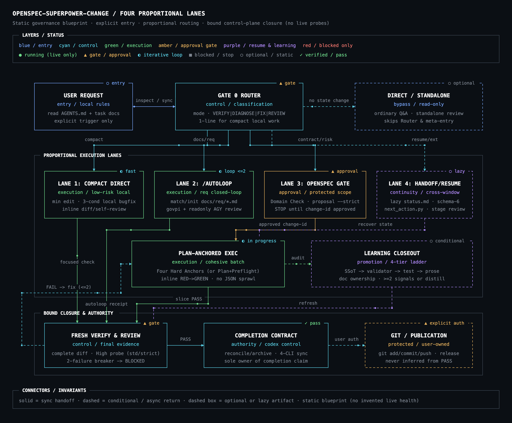
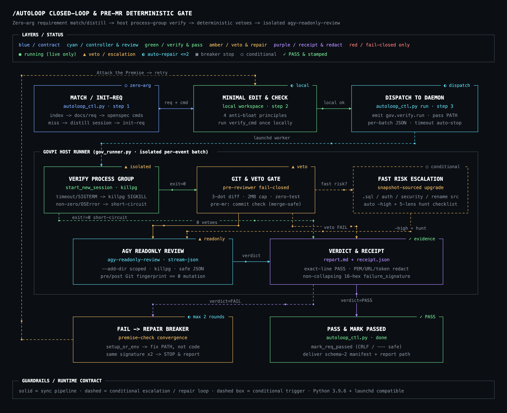

# openspec-superpower-change

[English](README.md) | [简体中文](README_cn.md)

`openspec-superpower-change` is an explicit-entry engineering change gate shared across **Codex**, **Pi**, **Antigravity CLI**, and **Grok CLI**. It connects repository-local rules, OpenSpec change contracts, Superpowers execution discipline, built-in `/autoloop` verification & read-only review, and evidence-based completion into one proportional workflow.

Ordinary questions, standalone read-only reviews, and everyday unconstrained edits bypass this Router. When work is explicitly routed here—or touches runtime control flow, public contracts, security, persistence, migrations, or workflow routing—the gate scales ceremony proportionally across four lanes instead of forcing a single heavy linear process.

## Core Workflow



> Interactive terminal blueprint (with animated orthogonal signal paths): [docs/diagrams/workflow-lanes.html](docs/diagrams/workflow-lanes.html)

| Lane | When to use | Execution & review posture |
|---|---|---|
| **1. Compact Direct Change** | Low-risk local edits, typos/docs/config, or a **three-condition localized bugfix** (failing-then-passing regression test, no external contract change, bounded local diff) | One-line Gate 0, minimum edit, targeted required checks, focused inline diff/self-review; no standalone Plan, Preflight, or `status.md` |
| **2. Daily `/autoloop` Closed-Loop** | Feature/bugfix slices backed by `docs/req/*.md` + `验收标准` (or active OpenSpec change / session-distilled contract) | `autoloop_ctl.py match` / `init-req` → minimal edit → `autoloop_ctl.py run` (host process-group verify + deterministic vetoes + isolated `agy-readonly-review`, up to 2 auto-repair rounds) |
| **3. OpenSpec-Backed Implementation** | New capabilities, public API/schema/migration, security, persistence, routing, or workflow lifecycle changes | Domain Context Check when ambiguous → `openspec validate <id> --strict` → **stop for explicit approval** → direct **Four Hard Anchors** execution (or Plan + bounded Preflight) → cohesive slices → distinct Review → learning closeout → fresh final verify/Review & archive |
| **4. External Handoff & Session Resume** | Multi-window recovery, compaction handoff, or explicitly delegated external-agent execution | Lazy `docs/agent-collab/<change-id>/status.md` (`local` schema-6 subset with stage-specific strict reviewer bindings, or full `external` schema-6 Handoff + schema-2 evidence manifests); read-only `scripts/next_action.py --status` |

## Highlights

- **Explicit-only entry & anti-drift locks**: Loads only on explicit OpenSpec/change-gate/routing requests, `迭代优化skill`, or archive/distill requests. Records Gate 0 with an explicit task lock (`VERIFY` | `DIAGNOSE` | `FIX` | `REVIEW`), enforces a two-failure circuit breaker on the same slice, and continues authorized same-scope work (including delegated reviews) without asking for repetitive confirmation.
- **Four Hard Anchors plan-anchored execution**: When approved OpenSpec `design.md` and `tasks.md` already define allowed/forbidden scope, `path:line` targets, cohesive batches, and exact verification commands, they serve directly as the executable Plan—eliminating duplicate Superpowers plans, standalone local Preflight JSONs, and intermediate `red-green.json` / `native-green.json` sprawl in favor of inline RED-to-GREEN proof.
- **Built-in `/autoloop` & `pre-mr` deterministic gate**: Zero-arg requirement matching (or automatic session distillation via `init-req`), isolated verification process groups (`start_new_session=True` + `os.killpg` on timeout/`SIGTERM`), pre-reviewer failure short-circuit, positive-count-exempted zero-test veto, fast-mode high-risk path escalation (`-high` + 5-lens conditional hunt checklist), credential/PEM redaction, non-collapsing `failure_signature`, portable merge-aware commit hygiene, and workspace-fingerprint-verified `agy-readonly-review`.
- **Schema-6 role-first authority & four-CLI parity**: Treats Codex, Pi, Antigravity CLI, and Grok CLI as equally eligible assigned executors/reviewers. Product names grant no authority; only the bound Codex `control-plane` / `control-plane-high` instance and contract own routing, evidence acceptance, canonical state, archive, and completion decisions. Current external Handoffs use schema 6 plus schema-2 evidence manifests; frozen schema-4/5 records remain read-only legacy audit history.
- **Cross-window session resume & read-only next-action query**: Lazy `docs/agent-collab/<change-id>/status.md` checkpoints bind verified source fingerprints (excluding `CHANGELOG.md`, ledgers, and historical reports), support stage-specific strict local reviewer bindings (`implementation-review` / `final-review`), isolate rare blocked-context amendments into `references/resume-context-amendments.md` behind the `COLD_PATH_START` marker, and expose `scripts/next_action.py --status` as an advisory read-only state transition query.
- **Project document ownership & 4-tier mechanical learning ladder**: Respects existing project directory conventions before falling back to purpose subdirectories (default engineering invariant target: `docs/engineering/engineering-invariants.md`), and prioritizes durable learning by mechanical strength: **(1) SSoT / dead-code removal → (2) static validators/types naming the replacement → (3) behavior regression tests → (4) prose guidance last**.
- **Transactional four-target runtime sync & bounded self-evolution**: Allowlisted schema-v2 scoped synchronization across Codex, Pi (`${PI_CODING_AGENT_DIR}/skills` & `APPEND_SYSTEM.md`), Antigravity CLI, and Grok CLI (with `grok inspect --json`), mode-`0600` transaction receipts, target-local rollback, managed governance block v6 (`CCG-001..CCG-016`), and a single-round `迭代优化skill` loop tracked in `docs/iteration/`.
- **Claim-to-Test Relevance Gate & specialist Review**: Binds every test command to current acceptance and demonstrated blast radius (`OUT_OF_SCOPE_PREEXISTING_DEBT` for unrelated frozen-baseline failures), and routes explicit backend proposal/design audits to read-only `backend-architecture-review`.

## Built-in `/autoloop` Closed-Loop & Pre-MR Gate



> Interactive terminal blueprint: [docs/diagrams/autoloop-flow.html](docs/diagrams/autoloop-flow.html)

```bash
# 1. Auto-match pending docs/req/*.md or active OpenSpec change (chaining its test commands)
python3 scripts/autoloop_ctl.py match --cwd "$PWD"

# 2. If unmatched, persist requirement & acceptance criteria distilled from the session
python3 scripts/autoloop_ctl.py init-req \
  --cwd "$PWD" --slug "<slug>" --title "<title>" \
  --summary "<scope & non-goals>" --cmd "<verify command>" --accept "<criteria>"

# 3. Run default fast closed-loop (medium reasoning; auto-escalates to -high + 5-lens hunt on .sql/auth/security/migration/rename src)
python3 scripts/autoloop_ctl.py run --cwd "$PWD"

# 4. Run strict pre-MR signoff (three-dot net diff, 2MB patch cap, merge-aware commit check, 5 conditional hunt lenses, high reasoning)
python3 scripts/autoloop_ctl.py run \
  --cwd "$PWD" --base-ref "origin/<target_branch>" \
  --commit-msg-file /private/tmp/commit_msg.txt --review-profile pre-mr
```

Key runtime guardrails enforced by `scripts/gov_runner.py`, `scripts/autoloop_ctl.py`, and `scripts/check_commit_text.py` (macOS Python 3.9.6 & `launchd` compatible):

- **Process-group isolation & short-circuit**: Runs `verify_command` in a dedicated session (`start_new_session=True`), kills the entire tree via `os.killpg(..., SIGKILL)` on timeout or `SIGTERM`, maps missing/non-executable commands to `127`/`126` (`setup_or_env_error`), and short-circuits before launching the reviewer CLI on any non-zero exit or deterministic veto.
- **Deterministic pre-reviewer vetoes**: Rejects `pre-mr` without `--base-ref`, unresolvable `--base-ref`, patches exceeding `2,000,000` bytes (`truncated=true`), clean worktrees with zero net diff, zero-test `exit 0` runs (exempted when any chained module reports a positive test count), and secret/hygiene failures in `check_commit_text.py` (exempting standard `Merge:` commits from Conventional Commit syntax while retaining secret scanning and applying `profile_cfg` to the first non-merge commit).
- **Redacted non-collapsing diagnostics & exact verdict anchoring**: Masks compound secret keys (`access_token`, `DB_PASSWORD`, `OPENAI_API_KEY`), `Bearer`/`Basic`/`Token` auth, password-only URLs (`redis://:pwd@host`), raw tokens, and full/truncated PEM private keys without swallowing trailing error lines; computes a 16-hex `failure_signature` across test IDs and normalized error/finding lines (stopping auto-repair immediately on two identical consecutive signatures); and enforces exact-line anchored `AUTOLOOP_VERDICT: PASS` plus zero workspace mutation across `agy-readonly-review`.

## Governed Caveman Lite

The built-in, default-off `governed-caveman-lite` profile makes ordinary Router prose concise while keeping professional full sentences. Enable it for the current conversation with `OpenSpec 精简模式：<任务>` (or send `OpenSpec 精简模式` before the task), and disable it with `OpenSpec 正常模式`.

The profile changes presentation only. It does not require an external Caveman skill, does not persist beyond the current conversation, and never compresses away governance fields, approvals, evidence, critical commands, or security and safety text.

## Architecture & Responsibility Map

| Capability | Responsibility | Owned By |
|---|---|---|
| Local project rules | Repository constraints, review artifacts, handoff rules, commit conventions | Project `AGENTS.md` / local docs |
| Project knowledge | Domain glossary, engineering invariants, ADRs, candidate provenance, regression enforcement | `CONTEXT.md`, `docs/engineering/engineering-invariants.md` (default), `docs/adr/`, Candidate Cards, tests/validators |
| OpenSpec | Single authoritative change contract, requirements, scenarios, approval state, Four Hard Anchors | `openspec/` |
| Superpowers | Phase-selected planning, TDD, systematic debugging, verification discipline | Superpowers skills via `references/superpowers-adapter.md` |
| Daily `/autoloop` gate | Zero-arg requirement match/distill, host verification, deterministic vetoes, isolated read-only AGY review | `scripts/autoloop_ctl.py`, `scripts/gov_runner.py`, `scripts/check_commit_text.py`, `references/autoloop-req-acceptance.md`, `references/autoloop-review-hunt.md` |
| Step Evidence Gate | Business-slice evidence profiles (`compact`, `standard`, `strict`) and inline RED-to-GREEN proof | `references/step-evidence-gate.md` |
| Completion Contract | Single Router-owned whole-task success, stop, evidence, learning, reconciliation, sync, and authority contract | `references/completion-contract.md` |
| Continuity & Resume | Lazy `status.md` checkpoints, stage-specific strict reviews, cold-path amendments, read-only transition query | `references/approved-implementation-workflow.md`, `references/resume-context-amendments.md`, `scripts/next_action.py` |
| Companion & Specialist Reviews | Standalone prompt/diff review & Handoff-backed batch review; explicit read-only backend architecture audits | `codex-brief-antigravity-review`; `backend-architecture-review` |
| openspec-superpower-change | Entry gate, proportional routing, risk classification, approval/evidence boundaries, self-evolution | This skill (`SKILL.md`) |

## Request Modes, Gate 0 & Evidence Profiles

| Mode | Use When | File Changes? |
|---|---|---:|
| Review-only | Assess architecture, OpenSpec need, authorization, risk, or completion evidence | No |
| Backend architecture Review | Explicit backend proposal/design audit (boundaries, contracts, transactions, performance, over-design) | No |
| Discovery First | Domain terms, actors, lifecycle, or boundaries remain unclear after inspecting code/docs | Glossary / context only |
| OpenSpec proposal | New capability, public behavior, API/schema/migration, security, persistence, or workflow changes | Proposal artifacts only |
| Approved implementation | Concrete OpenSpec `change-id` is explicitly approved | Yes (Four Hard Anchors or Plan + Preflight) |
| Direct Change | Low-risk local edits, docs/config/tests, or three-condition localized bugfix restoration | Yes, scoped |
| `/autoloop` closed-loop | Requirement doc (`docs/req/*.md`) + acceptance criteria verification & independent read-only review | Yes, gated by `govpi` |
| Self-Evolution | Modifying this skill, its references, scripts, validators, or sync rules (`迭代优化skill`) | Yes, Patch/Minor/Major gated |

**Gate 0** (recorded before state-changing edits, commands, or proposals; compressed to one line for obvious compact local work) states: active `mode`, `task` (`VERIFY` | `DIAGNOSE` | `FIX` | `REVIEW`), references read, OpenSpec decision and reason, selected Superpowers methods (or `none`), risk/evidence profile (`compact` | `standard` | `strict`), next action, and whether user confirmation is required.

- **Bounded Plan Preflight** (when a separate Plan/Brief is needed outside Four Hard Anchors / compact Direct Change): at most one `FULL_PREFLIGHT` plus one terminal `FOCUSED_RECHECK` by the same independent reviewer instance on unchanged protected boundaries; non-convergence routes to `CONTROL_PLANE_ADJUDICATION`.
- **Project Learning Layers**: Two independent correction/Review signals—or one high-severity security, integrity, data-loss, or false-PASS event, or an explicit archive-and-distill request—require durable promotion before fresh final verification (`CONTEXT.md` for glossary only, project guidance defaulting to `docs/engineering/engineering-invariants.md`, `docs/adr/NNNN-slug.md` for hard-to-reverse trade-offs, `docs/learning-candidates/YYYY-MM-DD-<slug>.md` for provenance, and deterministic tests/validators following the 4-tier mechanical ladder).
- **Workflow Baseline (2026-07-30)**: Evaluated Schemes A/B/C and retained **Scheme C** (OpenSpec + Superpowers + `codex-brief-antigravity-review`) for cross-project/cross-stack governance with traceable dependency upgrades rather than blind auto-tracking; see the [full evaluation](docs/design/2026-07-30-workflow-skill-optimization-evaluation.md) and [independent Review](docs/design/reviews/2026-07-30-workflow-skill-optimization-plan-c-archive-review.md).

## Repository Structure

```text
.
├── SKILL.md
├── references/
│   ├── request-modes.md
│   ├── direct-change-rule.md
│   ├── openspec-decision-rule.md
│   ├── proposal-workflow.md
│   ├── approved-implementation-workflow.md   # hot trunk + COLD_PATH_START resume tail
│   ├── resume-context-amendments.md          # cold-path blocked-context/rebind rules
│   ├── autoloop-req-acceptance.md            # zero-arg /autoloop closed-loop spec
│   ├── autoloop-review-hunt.md               # 5 conditional read-only hunt lenses
│   ├── step-evidence-gate.md
│   ├── completion-contract.md
│   ├── superpowers-adapter.md
│   ├── handoff-contract.md
│   ├── agent-capability-routing.md
│   ├── confirmation-lease.md
│   ├── local-instruction-checkpoint.md
│   ├── learning-candidate-pipeline.md
│   ├── project-learning-closeout.md          # includes Project Document Ownership
│   ├── response-patterns.md
│   ├── self-evolution-rule.md
│   ├── skill-iteration-loop.md               # bounded 迭代优化skill protocol
│   ├── sync-checklist.md
│   ├── cross-cli-sync.md
│   ├── cross-cli-portable-manifest.json
│   └── shared-global-governance.md           # managed block v6 (CCG-001..CCG-016)
├── scripts/
│   ├── autoloop_ctl.py                       # match / init-req / run / status / ensure
│   ├── gov_runner.py                         # host-side isolated verifier & reviewer runner
│   ├── check_commit_text.py                  # portable commit & added-diff hygiene gate
│   ├── next_action.py                        # read-only advisory transition query
│   ├── validate_core_gates.py                # core governance, handoff & resume validator
│   ├── validate_cross_cli_sync.py            # 4-CLI transactional plan/apply/verify-all
│   ├── build_codex_plugin.py                 # Codex plugin distribution generator
│   ├── build_skillsmp_adapter.py             # SkillsMP compatibility adapter generator
│   └── validate_distribution.py              # package, plugin & adapter validator
├── distribution/codex-plugin/                # generated Codex plugin distribution
├── skills/openspec-superpower-change/        # generated SkillsMP catalog adapter
├── templates/                                # OpenSpec, evidence, req & candidate templates
├── tests/                                    # 500+ stdlib unit, sync, distribution & runner tests
└── docs/
    ├── diagrams/                             # terminal-flow-diagram HTML blueprints & 2x PNGs
    ├── iteration/                            # BACKLOG.md, CURRENT.md, LOG.md, upstream-notes.md
    ├── distribution.md
    └── workflow.md
```

## Installation & Distribution

The repository root is the canonical Agent Skill source. Copy or link into your runtime skills directory:

```bash
mkdir -p "${CODEX_HOME:-$HOME/.codex}/skills"
cp -R openspec-superpower-change "${CODEX_HOME:-$HOME/.codex}/skills/openspec-superpower-change"
```

See [Distribution and installation](docs/distribution.md) for Agent Skills/GitHub, skills.sh, SkillsMP, Pi/npm, and Codex plugin paths. Rebuild generated adapters from the canonical source with `python3 scripts/build_codex_plugin.py .` and `python3 scripts/build_skillsmp_adapter.py .`. Third-party search refresh is asynchronous and is not guaranteed by generation, installation, or npm publication.

## Validation

Run static, distribution, and test validation after editing the skill:

```bash
/usr/bin/python3 -m py_compile scripts/*.py
"${PYTHON_BIN:-python3}" "${CODEX_HOME:-$HOME/.codex}/skills/.system/skill-creator/scripts/quick_validate.py" .
PYTHONDONTWRITEBYTECODE=1 python3 scripts/validate_core_gates.py .
PYTHONDONTWRITEBYTECODE=1 python3 scripts/validate_distribution.py .
PYTHONDONTWRITEBYTECODE=1 python3 -m unittest discover -s tests -v
```

Current governed status uses schema 6 with an immutable Reviewer Assignment. Validate its schema-2 evidence manifests, read-only next-action transitions, or project session resume checkpoints with:

```bash
# Full external Handoff status (+ --previous-status mandatory for complete)
PYTHONDONTWRITEBYTECODE=1 python3 scripts/validate_core_gates.py . \
  --status /project/docs/agent-collab/<change-id>/status.md \
  --artifact-root /project

# Read-only advisory next-action query
PYTHONDONTWRITEBYTECODE=1 python3 scripts/next_action.py \
  --status /project/docs/agent-collab/<change-id>/status.md

# Local/external project session resume checkpoint
PYTHONDONTWRITEBYTECODE=1 python3 scripts/validate_core_gates.py . \
  --resume-status /project/docs/agent-collab/<change-id>/status.md \
  --artifact-root /project
```

Each referenced artifact embeds a schema-2 evidence manifest that binds its role/result/change/batch/attempt/source fingerprint plus assigned product, instance, role, and capability profile. Before a transition introduces new evidence, validate a proposed status from outside the project with `--previous-status /project/docs/agent-collab/<change-id>/status.md`; this is mandatory for `complete`. Replace the one canonical status only after PASS, and do not persist a second marker block in the project.

Frozen schema-4/schema-5 records are legacy audit/drain inputs only. Inventory them separately; never pass them to current `--status` validation or migrate them into schema 6:

```bash
PYTHONDONTWRITEBYTECODE=1 python3 scripts/validate_core_gates.py . \
  --legacy-inventory-root /project \
  --legacy-inventory-output /private/tmp/legacy-drain.json
```

`quick_validate.py` requires PyYAML; set `PYTHON_BIN` accordingly. The project validator and test suite exercise the dependency-free fallback. Portable core-skill changes must additionally run `scripts/validate_cross_cli_sync.py` (`plan` → per-target `apply`/`verify`/`verify-discovery`/`commit-target` → `verify-all`) across Codex, Pi, Antigravity CLI, and Grok CLI (`grok inspect --json`), plus `scripts/autoloop_ctl.py ensure` when `gov_runner.py` or `check_commit_text.py` changes.

## Example Prompts

```text
Use openspec-superpower-change review-only mode. Read local rules, inspect this implementation plan, and report whether it requires OpenSpec. Do not modify files.
```

```text
Use Direct Change mode. Confirm this is a three-condition localized bugfix, add a failing-then-passing regression test, make the smallest fix, and report evidence.
```

```text
/autoloop
```

```text
Use backend-architecture-review for a read-only Review of this backend proposal. Inspect the actual project code and report only material boundary, contract, transaction, performance, stability, or over-design findings.
```

```text
Continue the approved task from its canonical Plan/Status/Handoff state. Do not restart completed work, create a second ledger, or expand scope without a new decision.
```

## Maintenance Notes

- Update both `README.md` and `README_cn.md` (and any affected blueprints under `docs/diagrams/`) for every published repository change so user-visible behavior, flows, validation, and compatibility stay aligned.
- Do not weaken approval gates, evidence gates, or completion-claim rules.
- When OpenSpec `design.md` and `tasks.md` define the Four Hard Anchors, they serve as the executable Plan; require a separate Superpowers plan only when those execution anchors are absent, and never use Superpowers planning to bypass OpenSpec approval.
- Do not let `CONTEXT.md` replace OpenSpec proposal artifacts, and do not let required project learning remain only in chat or prose when deterministic enforcement is practical.
- Do not sync runtime and open-source copies with directory-level overwrites; use `references/sync-checklist.md` and `scripts/validate_cross_cli_sync.py`.
- Do not complete verified-but-unreviewed work or claim OpenSpec closure with unreconciled tasks or missing post-archive strict validation.

## License

MIT. See [LICENSE](LICENSE).
