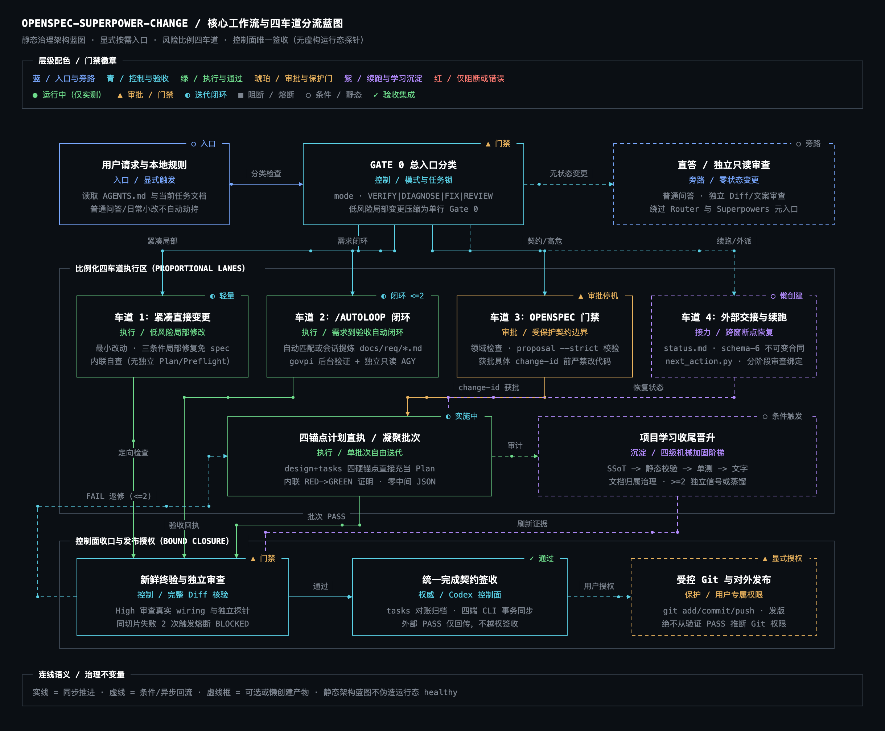
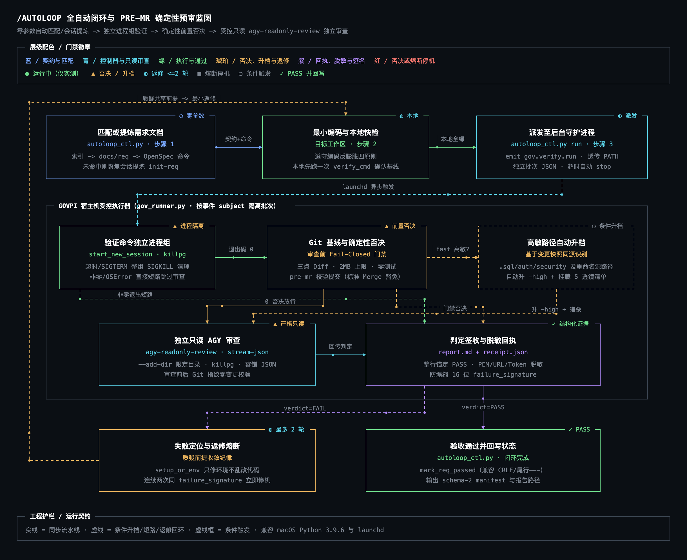

# openspec-superpower-change

[English](README.md) | [简体中文](README_cn.md)

`openspec-superpower-change` 是一个跨 **Codex**、**Pi**、**Antigravity CLI** 与 **Grok CLI** 四端共享真源的显式工程变更准入闸门。它将项目本地规则、OpenSpec 变更合同、Superpowers 执行纪律、内置 `/autoloop` 后台验证与独立只读审查，以及基于证据的统一完成契约整合成一套按风险比例分流的可复用工作流。

普通问答、独立只读 Review 与常规无受保护边界的小改动不会自动加载本路由。当任务显式进入本闸门，或涉及运行时控制流、公开契约、安全、持久化、数据库迁移或工作流路由时，本 Skill 按风险将执行分流至四条比例化车道，而非强加单一沉重的线性仪式。

## 核心工作流



> 交互式单文件终端蓝图（含正交流光动画）：[docs/diagrams/workflow-lanes-cn.html](docs/diagrams/workflow-lanes-cn.html)

| 车道 | 适用场景 | 执行与审查姿态 |
|---|---|---|
| **1. 紧凑直接变更（Compact Direct Change）** | 低风险局部修改、拼写/文档/小配置，或满足**三条件的局部 Bug 修复**（先红后绿回归单测、无外部契约变化、局部 Diff 有界） | 单行 Gate 0、最小改动、定向必需校验、聚焦内联 Diff/自查；无需独立 Plan、Preflight 或 `status.md` |
| **2. `/autoloop` 全自动闭环** | 带 `docs/req/*.md` + `验收标准` 的日常功能/修复切片（或活跃 OpenSpec 变更 / 会话自动提炼契约） | `autoloop_ctl.py match` / `init-req` → 最小编码 → `autoloop_ctl.py run`（宿主机进程组验证 + 确定性否决 + 受控只读 `agy-readonly-review`，最多 2 轮自动返修） |
| **3. OpenSpec 契约门禁与四锚点直执** | 新功能、公开 API/Schema/迁移、安全权限、持久化语义、路由或工作流生命周期变更 | 歧义时做领域检查 → `openspec validate <id> --strict` → **停机等待具体 `change-id` 批准** → 具备**四硬锚点**时直执（否则补 Plan + 有界 Preflight）→ 凝聚业务批次 → 独立审查 → 学习收尾 → 新鲜终验与归档 |
| **4. 外部交接与跨窗断点续跑** | 跨窗口/上下文压缩续跑，或显式外派外部 Agent 执行批次 | 懒创建 `docs/agent-collab/<change-id>/status.md`（本地 schema-6 瘦状态支持 strict 分阶段审查绑定，或完整外部 schema-6 Handoff + schema-2 证据清单）；只读 `scripts/next_action.py --status` 查询合法下一步 |

## 亮点

- **显式按需触发与防偏航硬锁**：仅在用户明确请求 OpenSpec/变更门禁/路由、`迭代优化skill` 或归档蒸馏时加载。Gate 0 显式记录任务锁（`VERIFY` | `DIAGNOSE` | `FIX` | `REVIEW`），同切片两次失败即触发熔断，已授权同范围任务（含委托审查）连续推进不反复打断确认。
- **四硬锚点计划直执（Four Hard Anchors）**：当已批准的 OpenSpec `design.md` 与 `tasks.md` 已明确允许/禁止范围、`path:line` 代码事实、凝聚批次与精确验证命令时，直接充当可执行 Plan——免除重复 Superpowers 计划、本地独立 Preflight JSON 以及 `red-green.json` / `native-green.json` 中间文件膨胀，改为内联 RED-to-GREEN 证明。
- **内置 `/autoloop` 与 `pre-mr` 确定性门禁**：支持零参数自动匹配需求或聚焦当前会话提炼 `init-req`，独立进程组超时/`SIGTERM` 整组 `killpg` 清理、非零退出前置短路、正计数豁免的零测试假绿否决、`fast` 模式高敏业务路径自动升档 `-high` + 五透镜条件猎杀清单、凭证/截断 PEM 脱敏、防塌缩 `failure_signature`、标准 Merge 提交豁免与零工作区变更校验的受控只读 `agy-readonly-review`。
- **Schema-6 角色优先权威与四端一致**：Codex、Pi、Antigravity CLI 与 Grok CLI 在被指派的 executor/reviewer 角色上资格同等。产品名本身不授予权限；只有绑定的 Codex `control-plane` / `control-plane-high` 实例及合同拥有路由、证据接受、canonical state、归档与完成决策权。当前外部协作使用 schema 6 与 schema-2 evidence manifest；冻结的 schema-4/schema-5 仅作只读 legacy 审计历史。
- **跨窗断点续跑与只读下一动作查询**：懒创建 `docs/agent-collab/<change-id>/status.md` 绑定已验证源码指纹（自动排除 `CHANGELOG.md`、台账与历史报告），支持 strict 本地分阶段审查绑定（`implementation-review` / `final-review`），将低频特例修订隔离至 `COLD_PATH_START` 冷路径分区与 `references/resume-context-amendments.md`，并提供 `scripts/next_action.py --status` 只读查询合法状态迁移。
- **项目文档归属治理与四级机械学习阶梯**：新建或迁移普通文档时先遵循项目既有目录约定，无约定时落入用途子目录（工程不变量默认目标升级为 `docs/engineering/engineering-invariants.md`）；满足晋升阈值时优先按机械强度加固：**（1）单一真源/删除死代码 →（2）指出正确替代路径的静态校验器/类型 →（3）行为回归单测 →（4）文字规则兜底**。
- **四端事务同步与受控自我迭代循环**：allowlist 驱动的 schema-v2 精确作用域同步覆盖 Codex、Pi（`${PI_CODING_AGENT_DIR}/skills` 与 `APPEND_SYSTEM.md`）、Antigravity CLI 与 Grok CLI（含 `grok inspect --json`），配备 mode-`0600` 事务回执、单目标原子回滚、托管治理块 v6（`CCG-001..CCG-016`），以及由 `docs/iteration/` 追踪的单轮 `迭代优化skill` 闭环协议。
- **Claim-to-Test 相关性门禁与后端架构专项审查**：每条测试命令必须锚定当前验收与已证明影响面（无关冻结基线失败登记为 `OUT_OF_SCOPE_PREEXISTING_DEBT` 不扩范围）；显式后端方案/设计审计路由至只读 `backend-architecture-review`。

## 内置 `/autoloop` 全自动闭环与 Pre-MR 预审门禁



> 交互式单文件终端蓝图：[docs/diagrams/autoloop-flow-cn.html](docs/diagrams/autoloop-flow-cn.html)

```bash
# 1. 自动匹配待办 docs/req/*.md 或活跃 OpenSpec 变更（自动串联其确定性测试命令）
python3 scripts/autoloop_ctl.py match --cwd "$PWD"

# 2. 若未匹配到，则从当前会话上下文提炼需求与验收标准并持久化
python3 scripts/autoloop_ctl.py init-req \
  --cwd "$PWD" --slug "<slug>" --title "<需求标题>" \
  --summary "<范围与非目标>" --cmd "<验证命令>" --accept "<验收标准>"

# 3. 执行默认 fast 闭环（medium 推理；触及 .sql/auth/security/migration 或重命名源路径自动升 -high + 五透镜猎杀）
python3 scripts/autoloop_ctl.py run --cwd "$PWD"

# 4. 执行严格 pre-mr 预审（三点净 Diff、2MB 补丁上限、Merge 友好提交检查、五条件猎杀透镜、high 推理）
python3 scripts/autoloop_ctl.py run \
  --cwd "$PWD" --base-ref "origin/<target_branch>" \
  --commit-msg-file /private/tmp/commit_msg.txt --review-profile pre-mr
```

由 `scripts/gov_runner.py`、`scripts/autoloop_ctl.py` 与 `scripts/check_commit_text.py` 强制落地的核心工程护栏（完全兼容 macOS Python 3.9.6 与 `launchd`）：

- **独立进程组隔离与前置短路**：`verify_command` 在独立会话组（`start_new_session=True`）中运行，超时或收到 `SIGTERM` 时经 `os.killpg(..., SIGKILL)` 清理整棵进程树；缺失或不可执行命令确定性映射为 `127`/`126`（`setup_or_env_error`）；任意非零退出或确定性否决均在启动只读审查 CLI 前短路收口。
- **审查前 Fail-Closed 确定性否决**：拦截 `pre-mr` 漏传 `--base-ref`、非法基线引用、超过 `2,000,000` 字节截断补丁（`truncated=true`）、工作区干净且无净变更的空跑、以及无正计数豁免的 `exit 0` 零测试假绿；`check_commit_text.py` 拦截密钥/私钥/`Co-authored-by:` 与非法提交格式，同时对 `git log` 中标准 `Merge:` 提交豁免格式校验并保留安全扫描与首个非 Merge 提交的策略校验。
- **全掩码脱敏、防塌缩签名与整行锚定签收**：对复合字段名（`access_token`、`DB_PASSWORD`、`OPENAI_API_KEY`）、`Bearer`/`Basic`/`Token` 认证、无用户名 URL（`redis://:pwd@host`）、裸 Token 与完整/截断 PEM 私钥全量脱敏且不误吞正常报错栈；基于失败测试 ID 与归一化核心行计算 16 位 `failure_signature`（连续两次同签名立即熔断停机）；以整行锚定正则校验 `AUTOLOOP_VERDICT: PASS` 并复核审查前后 Git 指纹零变更。

## 治理精简模式

内建且默认关闭的 `governed-caveman-lite` profile 会精简普通 Router 表达，同时保留专业、完整的句子。使用 `OpenSpec 精简模式：<任务>` 为当前会话启用，也可以先单独发送 `OpenSpec 精简模式`；使用 `OpenSpec 正常模式` 关闭。

该 profile 只改变呈现方式，不依赖外部 Caveman Skill，也不会跨会话保存。治理字段、审批、证据、关键命令以及安全文本不会被压缩或省略。

## 体系定位

| 能力 | 职责 | 归属 |
|---|---|---|
| 本地项目规则 | 仓库约束、Review 落盘、Handoff、提交规范 | 项目 `AGENTS.md` / 本地文档 |
| 项目知识 | 领域词汇、工程不变量、ADR、学习来源与回归约束 | `CONTEXT.md`、`docs/engineering/engineering-invariants.md`（默认）、`docs/adr/`、Candidate Card、测试/校验器 |
| OpenSpec | 唯一权威变更合同、需求、场景、审批状态与四硬锚点 | `openspec/` |
| Superpowers | 按阶段选择的计划、TDD、系统调试与验证纪律 | Superpowers skills（经 `references/superpowers-adapter.md`） |
| 日常 `/autoloop` 闭环 | 零参数需求匹配/提炼、宿主机验证、确定性否决、独立只读 AGY 审查 | `scripts/autoloop_ctl.py`、`scripts/gov_runner.py`、`scripts/check_commit_text.py`、`references/autoloop-req-acceptance.md`、`references/autoloop-review-hunt.md` |
| Step Evidence Gate | 业务切片证据等级（`compact`、`standard`、`strict`）与内联 RED-to-GREEN 证明 | `references/step-evidence-gate.md` |
| Completion Contract | Router 唯一拥有的整任务成功、停机、证据、学习、对账、同步与权威契约 | `references/completion-contract.md` |
| 连续执行与断点续跑 | 懒创建 `status.md` 检查点、分阶段 strict 审查、冷路径修订与只读下一动作查询 | `references/approved-implementation-workflow.md`、`references/resume-context-amendments.md`、`scripts/next_action.py` |
| 伴生与专项审查 | 独立 Prompt/Diff Review 与 Handoff 批次审查；显式后端架构只读评审 | `codex-brief-antigravity-review`；`backend-architecture-review` |
| openspec-superpower-change | 总准入闸门、比例化路由、风险分级、审批/证据边界与自我演进 | 本 Skill（`SKILL.md`） |

## 请求模式、Gate 0 与证据等级

| 模式 | 适用场景 | 是否改文件 |
|---|---|---:|
| Review-only | 评审架构、OpenSpec 必要性、授权、风险或完成证据 | 否 |
| 后端架构 Review | 显式评审后端方案/设计（边界、合同、调用链、事务、性能、过度设计） | 否 |
| Discovery First | 查完代码/文档后领域术语、参与者、生命周期或边界仍未澄清 | 仅词汇表 / context |
| OpenSpec proposal | 新能力、公开行为、API/Schema/迁移、安全、持久化或工作流变更 | 仅 proposal 产物 |
| Approved implementation | 具体 OpenSpec `change-id` 已明确获批 | 是（四硬锚点或 Plan + Preflight） |
| Direct Change | 低风险局部修改、文档/配置/测试，或三条件局部 Bug 修复恢复 | 是，受范围约束 |
| `/autoloop` 自动闭环 | 需求文档（`docs/req/*.md`）+ 验收标准验证与独立只读审查 | 是，受 `govpi` 门禁约束 |
| Self-Evolution | 修改本 Skill、参考文件、脚本、校验器或同步规则（`迭代优化skill`） | 是，受 Patch/Minor/Major 分级门禁约束 |

**Gate 0**（在任何改文件、状态变更命令或建提案前记录；明显低风险局部变更压缩为单行）包含：当前 `mode`、`task`（`VERIFY` | `DIAGNOSE` | `FIX` | `REVIEW`）、已读参考文件、OpenSpec 决策及理由、所需 Superpowers 方法（或 `none`）、风险/证据等级（`compact` | `standard` | `strict`）、下一步动作以及是否仍需用户确认。

- **有界 Plan Preflight**（在四硬锚点与紧凑直接变更之外需要独立 Plan/Brief 时）：同一变更谱系上限为 1 次 `FULL_PREFLIGHT` + 至多 1 次终局 `FOCUSED_RECHECK`（同一独立审查实例且受保护边界不变）；不收敛时交回 `CONTROL_PLANE_ADJUDICATION`。
- **项目学习分层**：同一不变量获 2 条独立纠正/Review 信号、或发生 1 次高危安全/完整性/数据丢失/假绿事件、或用户显式要求归档蒸馏时，必须在新鲜终验前完成持久化晋升（`CONTEXT.md` 仅放术语、工程不变量默认落 `docs/engineering/engineering-invariants.md`、`docs/adr/NNNN-slug.md` 记高成本取舍、`docs/learning-candidates/YYYY-MM-DD-<slug>.md` 记溯源，并按四级机械阶梯补齐校验器或回归单测）。
- **工作流基线（2026-07-30）**：经方案 A/B/C 对比评估，跨项目/跨技术栈治理继续采用 **方案 C**（OpenSpec + Superpowers + `codex-brief-antigravity-review`），依赖更新走可追溯受控验证而非静默自动升级；详见[完整评估](docs/design/2026-07-30-workflow-skill-optimization-evaluation.md)与[独立 Review](docs/design/reviews/2026-07-30-workflow-skill-optimization-plan-c-archive-review.md)。

## 仓库结构

```text
.
├── SKILL.md
├── references/
│   ├── request-modes.md
│   ├── direct-change-rule.md
│   ├── openspec-decision-rule.md
│   ├── proposal-workflow.md
│   ├── approved-implementation-workflow.md   # 热路径主干 + COLD_PATH_START 续跑冷尾
│   ├── resume-context-amendments.md          # 低频阻断修订/控制面重绑冷参考
│   ├── autoloop-req-acceptance.md            # 零参数 /autoloop 闭环规范
│   ├── autoloop-review-hunt.md               # 5 项条件只读猎杀透镜
│   ├── step-evidence-gate.md
│   ├── completion-contract.md
│   ├── superpowers-adapter.md
│   ├── handoff-contract.md
│   ├── agent-capability-routing.md
│   ├── confirmation-lease.md
│   ├── local-instruction-checkpoint.md
│   ├── learning-candidate-pipeline.md
│   ├── project-learning-closeout.md          # 含项目文档归属治理规则
│   ├── response-patterns.md
│   ├── self-evolution-rule.md
│   ├── skill-iteration-loop.md               # 单轮 迭代优化skill 协议
│   ├── sync-checklist.md
│   ├── cross-cli-sync.md
│   ├── cross-cli-portable-manifest.json
│   └── shared-global-governance.md           # 托管治理块 v6 (CCG-001..CCG-016)
├── scripts/
│   ├── autoloop_ctl.py                       # match / init-req / run / status / ensure
│   ├── gov_runner.py                         # 宿主机进程隔离验证与只读审查执行器
│   ├── check_commit_text.py                  # 便携提交文案与新增 Diff 卫生门禁
│   ├── next_action.py                        # 只读建议性状态迁移查询
│   ├── validate_core_gates.py                # 核心治理、Handoff 与续跑校验器
│   ├── validate_cross_cli_sync.py            # 四端事务 plan/apply/verify-all
│   ├── build_codex_plugin.py                 # Codex 插件分发包生成器
│   ├── build_skillsmp_adapter.py             # SkillsMP 兼容适配器生成器
│   └── validate_distribution.py              # npm 包、插件与适配器一致性校验器
├── distribution/codex-plugin/                # 生成的 Codex 插件分发产物
├── skills/openspec-superpower-change/        # 生成的 SkillsMP 目录兼容适配器
├── templates/                                # OpenSpec、证据、需求与学习候选模板
├── tests/                                    # 500+ 标准库单测、同步、分发与运行器测试
└── docs/
    ├── diagrams/                             # terminal-flow-diagram HTML 蓝图与 2x PNG
    ├── iteration/                            # BACKLOG.md、CURRENT.md、LOG.md、上游对照笔记
    ├── distribution.md
    └── workflow.md
```

## 安装与分发

仓库根目录是唯一的 Agent Skill 真源。复制或链接到运行时 skills 目录：

```bash
mkdir -p "${CODEX_HOME:-$HOME/.codex}/skills"
cp -R openspec-superpower-change "${CODEX_HOME:-$HOME/.codex}/skills/openspec-superpower-change"
```

关于 Agent Skills/GitHub、skills.sh、SkillsMP、Pi/npm 与 Codex 插件分发路径详见[分发与安装说明](docs/distribution.md)。根真源变更后使用 `python3 scripts/build_codex_plugin.py .` 与 `python3 scripts/build_skillsmp_adapter.py .` 刷新生成物。第三方搜索刷新为异步过程，生成、安装或 npm 发布成功不保证立即可搜索。

## 验证

修改 Skill 后运行静态校验、分发检查与全量测试：

```bash
/usr/bin/python3 -m py_compile scripts/*.py
"${PYTHON_BIN:-python3}" "${CODEX_HOME:-$HOME/.codex}/skills/.system/skill-creator/scripts/quick_validate.py" .
PYTHONDONTWRITEBYTECODE=1 python3 scripts/validate_core_gates.py .
PYTHONDONTWRITEBYTECODE=1 python3 scripts/validate_distribution.py .
PYTHONDONTWRITEBYTECODE=1 python3 -m unittest discover -s tests -v
```

当前受治理状态使用 schema 6，并包含不可变 Reviewer Assignment。使用以下命令验证其 schema-2 evidence manifest、只读下一动作查询或项目会话断点：

```bash
# 完整外部 Handoff 状态校验（complete 强制传 --previous-status）
PYTHONDONTWRITEBYTECODE=1 python3 scripts/validate_core_gates.py . \
  --status /project/docs/agent-collab/<change-id>/status.md \
  --artifact-root /project

# 只读建议性下一动作查询
PYTHONDONTWRITEBYTECODE=1 python3 scripts/next_action.py \
  --status /project/docs/agent-collab/<change-id>/status.md

# 本地/外部项目会话断点校验
PYTHONDONTWRITEBYTECODE=1 python3 scripts/validate_core_gates.py . \
  --resume-status /project/docs/agent-collab/<change-id>/status.md \
  --artifact-root /project
```

每个引用 artifact 都内嵌 schema-2 evidence manifest，绑定 role/result/change/batch/attempt/source fingerprint，以及被分配的 product、instance、role 和 capability profile。引入新证据的 transition 应先在项目外生成 proposed status，并加 `--previous-status /project/docs/agent-collab/<change-id>/status.md` 验证；`complete` 强制要求该参数。仅在 PASS 后替换唯一 canonical status，项目内不得持久化第二个 marker block。

冻结的 schema-4/schema-5 记录只能作为 legacy audit/drain 输入。必须单独盘点，不得交给当前 `--status` 校验，也不得迁移成 schema 6：

```bash
PYTHONDONTWRITEBYTECODE=1 python3 scripts/validate_core_gates.py . \
  --legacy-inventory-root /project \
  --legacy-inventory-output /private/tmp/legacy-drain.json
```

`quick_validate.py` 需要 PyYAML；请通过 `PYTHON_BIN` 选择可用解释器。项目校验器与测试套件同时覆盖无 PyYAML fallback。便携核心文件变动时，须通过 `scripts/validate_cross_cli_sync.py`（`plan` → 逐端 `apply`/`verify`/`verify-discovery`/`commit-target` → `verify-all`）完成 Codex、Pi、Antigravity CLI 与 Grok CLI（含 `grok inspect --json`）四端事务同步；若改动 `gov_runner.py` 或 `check_commit_text.py`，同步执行 `scripts/autoloop_ctl.py ensure` 刷新本机守护插件。

## 示例 Prompt

```text
Use openspec-superpower-change review-only mode. Read local rules, inspect this implementation plan, and report whether it requires OpenSpec. Do not modify files.
```

```text
Use Direct Change mode. Confirm this is a three-condition localized bugfix, add a failing-then-passing regression test, make the smallest fix, and report evidence.
```

```text
/autoloop
```

```text
Use backend-architecture-review for a read-only Review of this backend proposal. Inspect the actual project code and report only material boundary, contract, transaction, performance, stability, or over-design findings.
```

```text
Continue the approved task from its canonical Plan/Status/Handoff state. Do not restart completed work, create a second ledger, or expand scope without a new decision.
```

## 维护说明

- 每次发布仓库更新时同步更新 `README.md`、`README_cn.md`（及 `docs/diagrams/` 下受影响的流程蓝图），确保用户可见行为、流程、验证命令与兼容性保持一致。
- 不得削弱审批门禁、证据门禁或完成声明规则。
- 当 OpenSpec `design.md` 与 `tasks.md` 已完整定义四硬锚点时，它们直接充当可执行 Plan；仅在缺少执行锚点时要求独立 Superpowers Plan，且绝不用 Superpowers 计划绕过 OpenSpec 审批。
- 不得让 `CONTEXT.md` 替代 OpenSpec proposal 产物；当确定性约束可行时，不得让必需项目学习仅留在聊天或纯文字中。
- 不得用目录级覆盖同步运行时与开源副本，必须走 `references/sync-checklist.md` 与 `scripts/validate_cross_cli_sync.py`。
- 不得完成“已验证但未 Review”的工作，也不得在 OpenSpec 任务未对账或缺少归档后严格校验时声明合同闭环。

## License

MIT. See [LICENSE](LICENSE).
